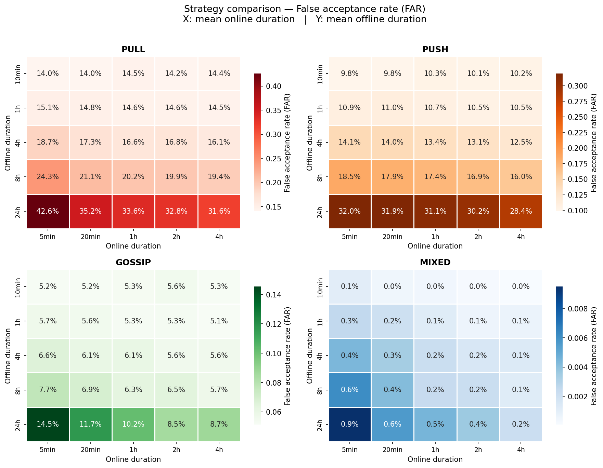
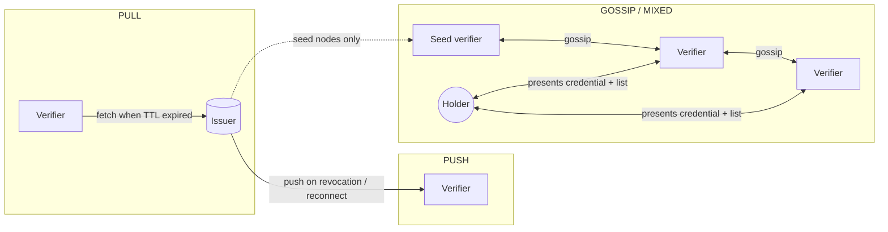
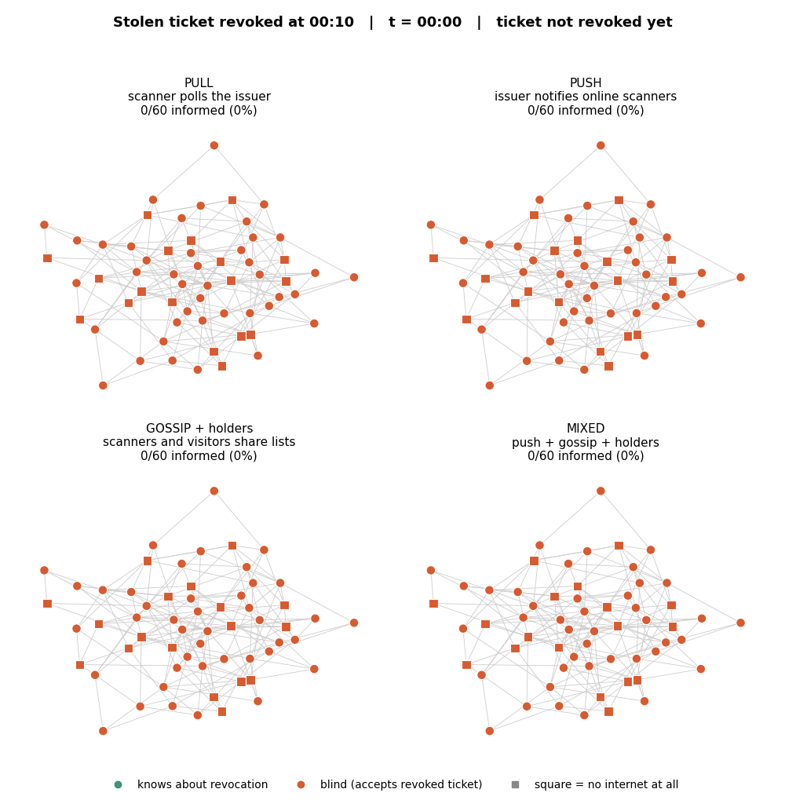
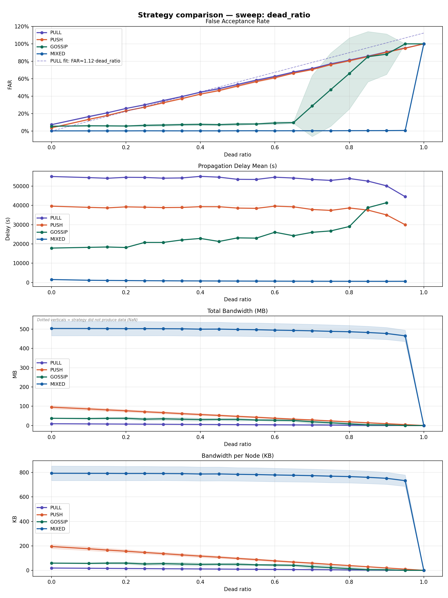
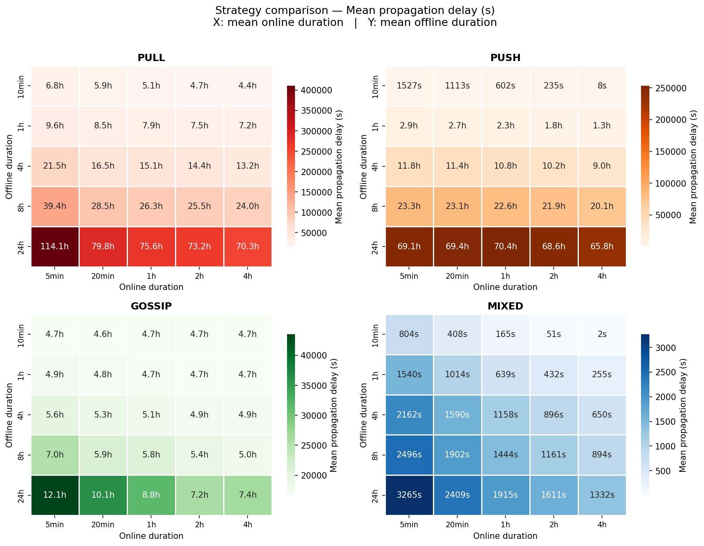
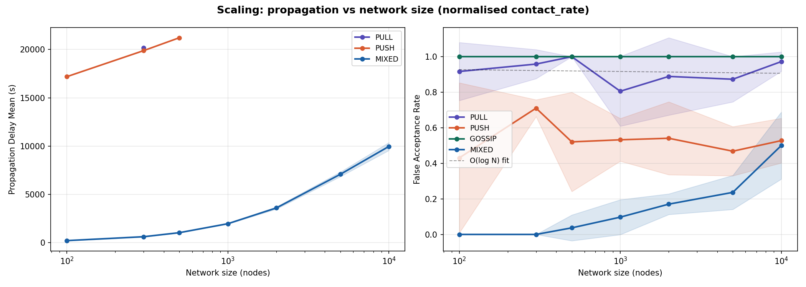
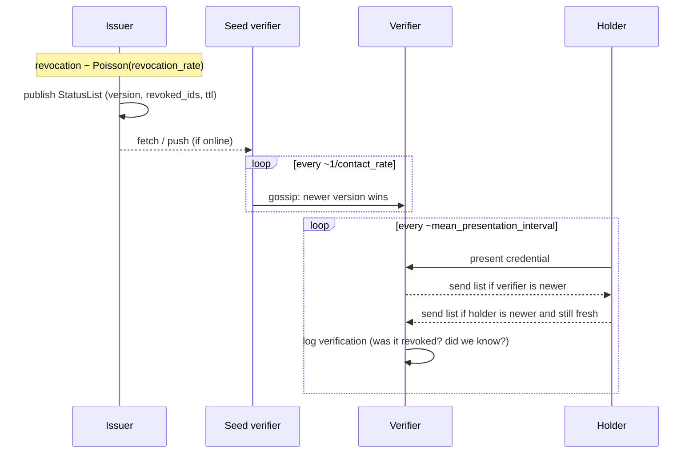

# DID Offline Revocation — Gossip Simulation


> Research context: Master's thesis, Riga Technical University (Cybersecurity) — credential revocation in decentralised Self-Sovereign Identity (SSI) systems.

A discrete-event simulator that compares **how credential-revocation information reaches verifiers that are often offline**: classic PULL and PUSH against peer-to-peer gossip and a hybrid that also lets credential holders carry fresh revocation lists between verifiers.

**Core question:** when many verifiers have no (or only intermittent) connection to the issuer, how long do they stay blind to a revocation, and how often do they wrongly accept a revoked credential (*false acceptance rate*, FAR)?



## Contents

- [Strategies](#strategies)
- [Quick start](#quick-start)
- [See it in action](#see-it-in-action-a-festival-example)
- [Key results](#key-results)
- [How the simulation works](#how-the-simulation-works)
- [Metrics](#metrics)
- [Parameters](#parameters)
- [Experiments](#experiments)
- [Project structure](#project-structure)

## Strategies

| Strategy | How a verifier learns about revocations | Needs issuer access? |
| --- | --- | --- |
| **PULL** | Periodically fetches the status list from the issuer when online and the cached list has expired (TTL). | Yes, every node |
| **PUSH** | Issuer pushes each new list to every node that is online (and also on reconnect). | Yes, every node |
| **GOSSIP** | Only a few *seed* nodes talk to the issuer; everyone else gets lists from random peers, and holders carry lists between verifiers. | Only seeds |
| **MIXED** | PUSH + P2P gossip + holder presentations combined. | Seeds + online nodes |



## Quick start

Requires Python 3.10+.

```bash
git clone https://github.com/Amaculis/DID-offline-revocation-gossips-solution.git
cd DID-offline-revocation-gossips-solution
pip install -r requirements.txt

# Compare all strategies once and print a table
python main.py
```

Edit `PARAMS` in [main.py](main.py) to change network size, TTL, dead ratio, etc. Several ready-made real-world scenarios (smart city, factory, expedition, …) are defined there too.

> **Tip:** start small. 500 nodes take roughly 30 s per strategy; 5 000 nodes take about 20 min per strategy. Use the multiprocessing sweeps below for larger studies.

## See it in action: a festival example

Imagine a festival where ticket scanners (the **verifiers**) have patchy mobile coverage: some are offline for hours and 30 % have no signal at all. At 00:10 the organiser (the **issuer**) revokes a stolen ticket. Each panel below shows the same 60 scanners; **red scanners would still accept the stolen ticket, green ones know it is revoked**. Squares are scanners with no internet.



- **PULL / PUSH** stall at 70 %: scanners without any connection to the issuer never find out.
- **GOSSIP** spreads the news scanner-to-scanner and through visitors who walk between scanners with their tickets.
- **MIXED** adds issuer pushes on top and is fastest.

Reproduce or change the scenario: `python experiments/animate_propagation.py --nodes 80 --hours 12`.

## Key results

Strategy comparison while increasing the share of **dead** nodes (nodes that never reach the issuer):



- **PULL** FAR grows roughly linearly with `dead_ratio` (fit ≈ 1.12 · dead_ratio): a node that cannot reach the issuer never learns anything.
- **GOSSIP** stays low until about 65 % dead nodes, then collapses because the gossip graph is no longer connected to a seed.
- **MIXED** keeps FAR close to zero almost everywhere and has by far the lowest propagation delay, **at the cost of the highest bandwidth** (≈ 800 KB per node in this setup).

How online/offline durations affect FAR (average online time on X, average offline time on Y):



Scaling with network size (contact rate normalised):



More plots (TTL and offline-ratio sweeps) are in [docs/img/](docs/img/); raw CSVs are in [experiments/results/](experiments/results/).

## How the simulation works

The simulator is built on [SimPy](https://simpy.readthedocs.io/) (discrete-event simulation). Every node is an independent SimPy process.



### Node states

Every node has two independent binary attributes:

| Attribute | Meaning |
| --- | --- |
| `is_online` | Connection to the issuer. Toggles with exponentially distributed durations (`mean_online_duration` / `mean_offline_duration`). |
| `is_dead` | The node has **no** issuer access, ever; it can only learn through P2P gossip. Fixed for the whole simulation. |

`is_online` only affects communication with the issuer (PULL fetch, PUSH delivery). P2P gossip happens independently of it.

### Seed nodes

In GOSSIP and MIXED, a fraction `seed_ratio` (default 1 %) of nodes have direct issuer access. Only they fetch new status lists and then spread them via gossip, modelling the realistic case where most verifiers are not connected to the issuer.

### Holder presentations (GOSSIP, MIXED)

A holder periodically (`mean_presentation_interval`) presents its credential to a random verifier (~6 neighbours). On each presentation:

1. If the holder's list is newer than the verifier's and not yet expired, the holder hands its list to the verifier.
2. If the verifier's list is newer, the verifier hands it to the holder.
3. The verifier logs a verification attempt (`is_presentation=True`).

## Metrics

| Metric | Description |
| --- | --- |
| `false_acceptance_rate` (FAR) | Share of verifications in which a node wrongly accepted a revoked credential. |
| `propagation_delay_mean_s` | Mean time from a revocation until nodes learn about it (dead nodes excluded). |
| `propagation_delay_p95_s` | Time within which 95 % of nodes have learned about a revocation. |
| `coverage_rate` | Share of revocations that reached 95 % of nodes during the simulation. |
| `bandwidth_per_node_kb` | Mean bytes transferred per node (receiver side only). |
| `storage` | Per-node storage of the status list (mean / max). |
| `list_age` | Age of the cached list at verification time. |

## Parameters

| Parameter | Default | Description |
| --- | --- | --- |
| `network_size` | 500 | Number of verifiers |
| `dead_ratio` | 0.1 | Share of nodes without issuer access |
| `offline_ratio` | 0.2 | Initial share of offline nodes (also sets the steady state) |
| `ttl` | 28800 | StatusList validity (seconds) |
| `revocation_rate` | 0.001 | Revocations per second |
| `mean_online_duration` | 3600 | Mean online period (s) |
| `mean_offline_duration` | 14400 | Mean offline period (s) |
| `contact_rate` | 1/600 | Gossip contacts per node per second |
| `seed_ratio` | 0.01 | Share of nodes with direct issuer access (GOSSIP/MIXED) |

## Experiments

### Averaged runs

Runs each strategy N times with different seeds and averages the results. Handy as a quick sanity check.

```bash
python experiments/run_averaged.py            # 5 seeds (default)
python experiments/run_averaged.py --runs 20
```

### Parameter sweeps

Sweeps each parameter independently and writes CSVs to `experiments/results/`.

```bash
# Full sweep, 10 seeds per point, uniform (non-adaptive)
python experiments/run_sweep.py --runs 10 --no-adaptive --workers 8

# Selected dimensions only
python experiments/run_sweep.py --runs 10 --no-adaptive --dims dead_ratio offline_ratio ttl

# Two-parameter sweep (ttl x dead_ratio)
python experiments/run_sweep.py --runs 10 --no-adaptive --2d --workers 8

# Adaptive mode: add seeds at high-variance points (CV > 1.0 -> up to 15 seeds)
python experiments/run_sweep.py --runs 5 --max-runs 15 --cv-threshold 1.0 --workers 8
```

| Flag | Default | Description |
| --- | --- | --- |
| `--runs N` | 5 | Seeds per sweep point |
| `--max-runs N` | 15 | Max seeds for high-CV points (adaptive mode) |
| `--cv-threshold F` | 1.0 | Coefficient of variation above which extra seeds are added |
| `--no-adaptive` | off | Use exactly `--runs` seeds everywhere |
| `--workers N` | cpu_count | Parallel workers |
| `--dims` | all | Dimensions to sweep (space-separated) |
| `--2d` | off | Also run the 2D sweep (TTL × dead_ratio) |

**Available dimensions:** `dead_ratio`, `offline_ratio`, `revocation_rate`, `ttl`, `network_size`, `mean_offline_duration`, `mean_online_duration`

Notes:

- `offline_ratio` automatically adjusts `mean_offline_duration`: `mean_offline = mean_online × ratio / (1 − ratio)`.
- `network_size` automatically normalises `contact_rate` so the per-node meeting frequency stays realistic.

### Scaling tests

Measures propagation delay and FAR for networks up to 1 000 000 nodes, using a 1-day `sim_duration` and normalised `contact_rate` to keep run times manageable.

```bash
python experiments/run_scaling.py --max-n 100000 --runs 3 --workers 8   # a few minutes
python experiments/run_scaling.py --runs 3 --workers 8                  # up to 1M nodes, 20-40 min
python experiments/run_scaling.py --max-n 10000 --runs 5 --workers 4
```

Outputs `experiments/results/scaling_network_size.csv` and `.png`.

### Plotting

```bash
# PNGs from every CSV in experiments/results/ (95% CI bands, NaN annotations, PULL linear fit)
python experiments/plot_results.py

# 2D heatmaps
python experiments/plot_heatmap_2d.py                                   # FAR (default)
python experiments/plot_heatmap_2d.py --metric delay_mean_mean          # propagation delay
python experiments/plot_heatmap_2d.py --metric bandwidth_per_node_kb_mean
python experiments/plot_heatmap_2d.py --metric far_mean --shared-scale  # same color scale for all 4
python experiments/plot_heatmap_2d.py --csv my_data.csv --output out.png
```

### Output files

All saved under `experiments/results/`:

| File | Description |
| --- | --- |
| `sweep_{dim}.csv` | 1D sweep results: mean, std and 95 % CI for every metric |
| `sweep_{dim}.png` | Plots with 95 % CI bands |
| `sweep2d_*.csv` | 2D sweep results |
| `sweep2d_*_far.png`, `sweep2d_*_delay.png` | FAR and delay heatmaps |
| `scaling_network_size.csv` / `.png` | Network-size scaling results |

## Project structure

```text
main.py                      # run all strategies once and print a comparison table
sim/
├── common/
│   ├── models.py            # StatusList, RevocationEvent, VerificationAttempt, NodeStats
│   ├── issuer.py            # Issuer: generates revocations, serves PUSH subscribers
│   ├── metrics.py           # summarize(), propagation_delay(), false_acceptance_rate(), ...
│   └── network.py           # build_graph(), assign_initial_states(), assign_dead_nodes()
├── strategies/
│   ├── pull.py              # PullNode: periodic TTL-based fetch
│   ├── push.py              # PushNode: receives pushes from the issuer
│   ├── gossip.py            # GossipNode: P2P gossip between verifiers
│   ├── holder_gossip.py     # HolderGossipNode + HolderNode: gossip + holder presentations
│   ├── push_holder_gossip.py        # MIXED: PUSH + gossip + holder
│   └── verification_gossip.py       # experimental verification gossip
└── run_*.py                 # one runner per strategy
experiments/
├── run_sweep.py             # 1D/2D parameter sweeps (multiprocessing)
├── run_scaling.py           # network-size scaling (up to 1M nodes)
├── run_averaged.py          # quick N-seed averaged run
├── plot_results.py          # plots from CSV files
├── plot_heatmap_2d.py       # 2D heatmaps
├── animate_propagation.py   # animated GIF of one revocation spreading
└── results/                 # CSV / PNG outputs
docs/img/                    # figures used in this README
graphs/                      # design diagrams (Mermaid / draw.io)
```
